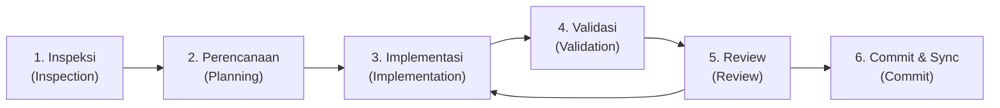

# 🌸 Buku Panduan Serah-Terima Pengembang & Pengurus
## Website Resmi Mirai no Webu — MIRAI NO HANA SMA Wachid Hasyim 2 Taman Sidoarjo

Selamat datang, Pengurus dan Pengembang Generasi Penerus Klub Bahasa & Kebudayaan Jepang **MIRAI NO HANA**! 🎌

Dokumen ini disusun sebagai **Buku Saku Serah-Terima Jabatan (Sertijab)** untuk memandu Anda memahami, merawat, dan mengembangkan website **Mirai no Webu**. Website ini dirancang 100% mandiri oleh siswa anggota klub sebagai ruang berkarya, wadah belajar interaktif, etalase ekstrakurikuler kita, dan laboratorium kolaborasi coding modern bersama **AI Coding Agent**.

---

## 📑 Daftar Isi
0. [Bab 0: Persiapan Lingkungan Kerja (VS Code, Git, GitHub & Ekstensi)](#-bab-0-persiapan-lingkungan-kerja-vs-code-git-github--ekstensi)
   - [0.1 Instalasi Software Dasar](#01-instalasi-software-dasar)
   - [0.2 Setup Git & Identitas Kontributor GitHub](#02-setup-git--identitas-kontributor-github)
   - [0.3 Konfigurasi VS Code: File Nesting & Efisiensi Indexing](#03-konfigurasi-vs-code-file-nesting--efisiensi-indexing)
   - [0.4 Ekstensi VS Code: Rekomendasi Workspace vs Ekstensi Terpasang](#04-ekstensi-vs-code-rekomendasi-workspace-vs-ekstensi-terpasang)
   - [0.5 Menggunakan Utility Class Universal (.mirai-card-*)](#05-menggunakan-utility-class-universal-mirai-card-)
1. [Pengenalan Arsitektur Web (Zero-Framework Web Standards)](#1-pengenalan-arsitektur-web-zero-framework-web-standards)
2. [Peta Berkas & Folder Lengkap (File Map & Clean Root)](#2-peta-berkas--folder-lengkap-file-map--clean-root)
3. [Tutorial Langkah-demi-Langkah Update Konten Rutin](#3-tutorial-langkah-demi-langkah-update-konten-rutin)
   - [3.1 Tambah Info Lomba & Acara Baru](#31-tambah-info-lomba--acara-baru)
   - [3.2 Update Skor & Leaderboard Peringkat](#32-update-skor--leaderboard-peringkat)
   - [3.3 Tambah Produk Toko / Konbini](#33-tambah-produk-toko--konbini)
   - [3.4 Tambah Foto Dokumentasi Program Kerja](#34-tambah-foto-dokumentasi-program-kerja)
   - [3.5 Update Kepengurusan Baru saat Sertijab](#35-update-kepengurusan-baru-saat-sertijab)
4. [Standar Desain & Estetika Visual Wajib (7 Sistem Universal & Anti-AI Slop)](#4-standar-desain--estetika-visual-wajib-7-sistem-universal--anti-ai-slop)
5. [Kolaborasi Modern AI Coding Agent (Workflow & Prompt Engineering)](#5-kolaborasi-modern-ai-coding-agent-workflow--prompt-engineering)
   - [5.1 Metodologi Prompt F-A-K-T-A](#51-metodologi-prompt-f-a-k-t-a)
   - [5.2 Dua Contoh Prompt F-A-K-T-A Realistis](#52-dua-contoh-prompt-f-a-k-t-a-realistis)
   - [5.3 Matriks Role AI Agent & Kapan Menggunakannya](#53-matriks-role-ai-agent--kapan-menggunakannya)
   - [5.4 Workflow Terstruktur 6 Langkah AI Agent](#54-workflow-terstruktur-6-langkah-ai-agent)
   - [5.5 Penempatan Berkas Konfigurasi AI Resmi](#55-penempatan-berkas-konfigurasi-ai-resmi)
6. [Panduan Alur Git & Deployment GitHub Pages](#6-panduan-alur-git--deployment-github-pages)
7. [Checklist Serah-Terima Jabatan & Kontak](#7-checklist-serah-terima-jabatan--kontak)

---

## 🎨 7 Sistem Visual & Transparansi Pattern Universal (Master Design Standard)

Seluruh pengembang dan AI asisten **WAJIB mematuhi 7 Aturan Visual Universal** ini untuk menjaga konsistensi, estetika, dan keterbacaan (WCAG AAA) di seluruh halaman Mirai no Webu:

1. **Master Variabel Pattern & Gradien Terpusat di `:root` (`css/pages/global.css`)**:
   - `--pattern-c1w: url("../../images/mirai/background/c1w.jpeg");` (Kumo/Awan Terang)
   - `--pattern-c1b: url("../../images/mirai/background/c1b.jpeg");` (Kumo/Awan Gelap)
   - `--pattern-w1w: url("../../images/mirai/background/w1w.jpeg");` (Wagara/Ombak Terang)
   - `--pattern-w1b: url("../../images/mirai/background/w1b.jpeg");` (Wagara/Ombak Gelap)
   - `--overlay-card-light: linear-gradient(135deg, rgba(255, 255, 255, 0.96), rgba(255, 252, 254, 0.96));` (Gradien penutup terang untuk watermark 4.5% kartu)
   - `--overlay-card-dark: linear-gradient(155deg, rgba(16, 12, 22, 0.96), rgba(10, 8, 14, 0.97));` (Gradien penutup gelap untuk watermark 4.5% kartu)
   - `--overlay-section-dark: linear-gradient(180deg, rgba(14, 11, 18, 0.95), rgba(14, 11, 18, 0.96));`

2. **Kunci Transparansi Watermark Sangat Lembut (Maksimal Keterbacaan Teks)**:
   - Pola Terang & Gelap: Dikunci pada **`opacity: 0.045 !important`** (hover: `0.07 !important`) dan gradien penutup master di `:root` sebesar `0.95`–`0.97` agar teks kartu sangat jernih, tajam, dan tidak terganggu oleh garis gelombang latar.

3. **Seksi Selang-Seling Bersih & Polos (Pattern HANYA pada Kartu, DILARANG pada Halaman/Seksi)**:
   - Semua `<section>` konten setelah Hero wajib memiliki latar belakang solid yang 100% bersih, polos, dan bebas dari pattern gambar latar (`background-image: none !important;`):
     - Seksi Ganjil (`nth-of-type(odd)`): Putih Bersih (`#ffffff`) polos dengan teks kontras tinggi (`#18151b` / `#554e57`).
     - Seksi Genap (`nth-of-type(even)`): Hitam Obsidian (`#111111`) polos dengan teks kontras terang (`#ffffff` / `#d5ccd3`).
   - Gunakan utility class `.mirai-section-light` dan `.mirai-section-dark` saat membuat seksi baru.

4. **Sistem Whitelist & Utility Class Kartu Resmi (Anti-Wildcard Rusak)**:
   - **DILARANG KERAS** memakai selector wildcard agresif seperti `[class*="-card"]` atau `[class*="-box"]` yang memaksa sub-elemen mewarisi border/background.
   - Gunakan utility class resmi `.mirai-card-light` dan `.mirai-card-dark` yang sudah dibekali guard `:not()` otomatis untuk seluruh elemen anak (`*-head`, `*-header`, `*-point-card`, `*-badge`, dll.).

5. **Aturan Anti-Double-Pattern pada Sub-Kartu (Inner Boxes)**:
   - Semua kotak/panel anak di dalam kartu utama (seperti `.quote-char-box`, `.quote-speech-box`, `.quote-meaning-box`, profile box, badge box, dll.) WAJIB menggunakan latar solid/glass (`background: rgba(255, 255, 255, 0.94) !important;` di kartu terang, `background: rgba(24, 19, 34, 0.90) !important;` di kartu gelap) TANPA pattern gambar (`background-image: none !important`), memastikan teks 100% bersih, jernih, dan tidak bertabrakan dengan background.

6. **Harmoni Motif Berbasis Karakter Halaman**:
   - Halaman Interaktif & Dinamis (Beranda, Kamus, Rekomendasi, Lomba, Toko): Menggunakan motif Kumo Awan (`--pattern-c1w` / `--pattern-c1b`).
   - Halaman Kurikulum & Prestasi (Kelas, Kegiatan, Peringkat, Tentang): Menggunakan motif Ombak Seigaiha (`--pattern-w1w` / `--pattern-w1b`).

7. **Standar Kontras & Aksesibilitas WCAG AAA**:
   - Di seksi terang: Heading berwarna `#18151b`, paragraf `#554e57`, aksen pink `#e91e63`.
   - Di seksi gelap: Heading berwarna `#ffffff`, paragraf `#d5ccd3`, aksen pink `#ff4f91` atau `#ff659b`.

---

## 🚀 Bab 0: Persiapan Lingkungan Kerja (VS Code, Git, GitHub & Ekstensi)

Selamat datang di tim pengembang **Mirai no Webu**! Bagian ini disusun secara ramah pemula agar siapa pun pengurus atau anggota klub yang baru ditunjuk dapat menyiapkan perangkat komputer/laptopnya dari nol hingga siap mengedit website dengan rapi, aman, dan efisien.

---

### 0.1 Instalasi Software Dasar
Sebelum membuka proyek, pastikan Anda telah memasang 3 perangkat lunak esensial berikut:
1. **Visual Studio Code (VS Code)** *(Wajib)*:
   - Unduh gratis di situs resmi: [code.visualstudio.com](https://code.visualstudio.com/).
   - Editor kode standar industri yang sangat ringan, cepat, dan memiliki ekosistem ekstensi terlengkap.
2. **Git Version Control** *(Wajib)*:
   - Unduh di: [git-scm.com](https://git-scm.com/).
   - Digunakan untuk mencatat riwayat perubahan kode (commit) dan menyinkronkan website ke repositori GitHub.
3. **Python 3 (v3.10+)** *(Sangat Dianjurkan)*:
   - Unduh di: [python.org](https://www.python.org/).
   - **PENTING saat instalasi di Windows**: Centang opsi **"Add python.exe to PATH"** agar perintah `python` dapat dipanggil langsung dari terminal VS Code untuk menjalankan skrip otomasi pengurus di folder `skrip/`.

---

### 0.2 Setup Git & Identitas Kontributor GitHub
Agar kontribusi kode Anda dihitung dan foto profil Anda muncul di daftar **Contributors** di halaman utama GitHub repositori, Anda wajib mengonfigurasi nama dan email lokal yang cocok dengan akun GitHub Anda:

```bash
# 1. Atur Nama Pengguna GitHub Anda
git config user.name "nihongokurabuwh"

# 2. Atur Alamat Email yang Terdaftar di Akun GitHub Anda
git config user.email "email-anda@gmail.com"
```

> [!TIP]
> **Solusi Error "Failed to authenticate to git remote" saat Push**:
> Jika VS Code memunculkan peringatan otentikasi gagal (`remote: Invalid username or token. fatal: Authentication failed`):
> 1. Buka browser, masuk ke akun GitHub Anda -> **Settings** -> **Developer Settings** -> **Personal Access Tokens (Tokens classic)**.
> 2. Buat token baru dengan izin centang `repo` dan `workflow`.
> 3. Gunakan token tersebut sebagai *password* saat VS Code atau Git terminal meminta otentikasi kata sandi.
> 4. Atau gunakan ekstensi **GitHub Pull Requests and Issues** untuk login 1 klik via browser.

---

### 0.3 Konfigurasi VS Code: File Nesting & Efisiensi Indexing
Workspace ini telah dibekali berkas konfigurasi otomatis `.vscode/settings.json` yang mengunci standar kerapian:

1. **File Nesting Otomatis (`explorer.fileNesting.enabled: true`)**:
   - Di root direktori, file pelengkap web/PWA (`404.html`, `offline.html`, `manifest.webmanifest`, `service-worker.js`, `robots.txt`, `sitemap.xml`, `favicon.ico`, `favicon.png`) secara otomatis **dikelompokkan rapi di bawah `index.html`**.
   - Berkas konfigurasi linter & AI (`cspell.json`, `.cursorignore`, `.cursorrules`) **dikelompokkan di bawah `.gitignore`**.
   - Hasilnya, sidebar explorer terlihat sangat ringkas, bersih, dan profesional tanpa risiko merusak letak fisik file yang dibutuhkan browser dan hosting.
2. **Format on Save Otomatis**:
   - `editor.formatOnSave: true` dan `editor.tabSize: 2` memastikan baris kode selalu rapi setiap kali menekan `Ctrl + S`.
3. **Pengecualian File Berat (Search & Watcher Exclude)**:
   - Folder `.venv/`, `.cache/`, `data/*.json`, dan berkas dataset raksasa `js/stroke-data.js` serta `js/kamus-kanji-data.js` secara otomatis disembunyikan dari pencarian teks dan file watcher agar VS Code dan AI Agent tetap berjalan **sangat kencang dan hemat memori**.

---

### 0.4 Ekstensi VS Code: Rekomendasi Workspace vs Ekstensi Terpasang

Repositori ini membedakan antara **Ekstensi Rekomendasi Standar** (paket minimum untuk pemula yang tercatat di `.vscode/extensions.json`) dengan **Ekstensi Terpasang di Lingkungan Pengembang** (ekstensi produktivitas lanjutan):

#### A. Rekomendasi Workspace Resmi (`.vscode/extensions.json`)
Cukup buka tab Ekstensi (`Ctrl + Shift + X`), ketik `@recommended`, dan klik **"Install Workspace Recommended Extensions"**:

| Nama Ekstensi | Identifier | Fungsi Utama |
| :--- | :--- | :--- |
| **Prettier - Code formatter** | `esbenp.prettier-vscode` | Merapikan baris & indentasi HTML/CSS/JS otomatis saat menyimpan file (`Ctrl + S`). |
| **Live Server** | `ritwickdey.LiveServer` | Menjalankan preview website di browser lokal dengan 1 klik ("Go Live" di status bar). |
| **Code Spell Checker** | `streetsidesoftware.code-spell-checker` | Mencegah typo penulisan teks dan variabel kode, terhubung ke kamus `cspell.json`. |
| **Python** | `ms-python.python` | Menjalankan skrip otomasi pemeliharaan web di folder `skrip/` langsung dari editor. |
| **Auto Rename Tag** | `formulahendry.auto-rename-tag` | Otomatis mengubah tag penutup saat tag pembuka HTML diedit, mencegah bug tag tak seimbang. |
| **HTML CSS Support** | `ecmel.vscode-html-css` | Menampilkan rekomendasi autocomplete class CSS saat mengetik di file HTML. |
| **Path Intellisense** | `christian-kohler.path-intellisense` | Membantu penulisan path relatif file/gambar (misal `../../images/...`) tanpa takut salah ketik. |
| **Color Highlight** | `naumovs.color-highlight` | Menampilkan kotak warna visual langsung pada kode warna hex/RGBA di stylesheet CSS. |
| **VS Code Pets** | `tonybaloney.vscode-pets` | Menghadirkan hewan animasi kecil lucu di panel editor untuk menemani Anda ngoding! 🐱🐶 |

#### B. Ekstensi Terpasang di Lingkungan Pengembang (Advanced DevOps & AI)
Berikut ekstensi tambahan yang saat ini aktif di workstation pengembang untuk produktivitas tim:

| Ekstensi Tambahan | Identifier | Manfaat Nyata |
| :--- | :--- | :--- |
| **Google Antigravity** | `google.google-antigravity` | Asisten AI Agent utama berkonteks besar untuk eksekusi tugas coding otomatis. |
| **GitLens** | `eamodio.gitlens` | Melihat siapa yang terakhir mengubah baris kode (git blame) dan memantau riwayat commit. |
| **GitHub Pull Requests** | `github.vscode-pull-request-github` | Mengelola PR, issue, dan otentikasi login GitHub langsung dari VS Code. |
| **ErrorLens** | `usernamehw.errorlens` | Menampilkan pesan error linter dan typo langsung inline di ujung baris kode. |
| **Material Icon Theme** | `pkief.material-icon-theme` | Ikon folder dan file yang sangat representatif untuk navigasi visual yang cepat. |
| **CodeSnap** | `adpyke.codesnap` | Menghasilkan tangkapan layar cuplikan kode yang estetik untuk dokumentasi dan laporan. |

---

### 0.5 Menggunakan Utility Class Universal (`.mirai-card-*`)
Untuk memastikan siapa pun pengurus baru yang menambah konten tidak akan merusak layout atau membuat selector wildcard yang bentrok, gunakan **Utility Classes Resmi** yang sudah disediakan di `css/pages/global.css`:

1. **Membuat Seksi Halaman Baru**:
   - Seksi Tema Terang: `<section class="section mirai-section-light">`
   - Seksi Tema Gelap: `<section class="section mirai-section-dark">`
2. **Membuat Kartu Konten Baru**:
   - Kartu Cerah Berpola Halus:
     ```html
     <div class="mirai-card-light">
       <h3>Judul Kartu</h3>
       <p>Deskripsi konten kartu...</p>
     </div>
     ```
   - Kartu Gelap Berpola Halus:
     ```html
     <div class="mirai-card-dark">
       <h3>Judul Kartu</h3>
       <p>Deskripsi konten kartu...</p>
     </div>
     ```
3. **Keuntungan Utility Class Ini**:
   - Kartu otomatis memiliki radius melengkung 18px, border beraksen pink lembut, dan watermark pattern halus (4.5% opacity).
   - Sudah terpasang **guard anti-double pattern**: elemen di dalam kartu (judul, header, icon, badge) diproteksi secara otomatis agar tidak memiliki kotak border ganda atau latar bertumpuk.

---

## 1. Pengenalan Arsitektur Web (Zero-Framework Web Standards)

Website Mirai no Webu sengaja dibangun menggunakan prinsip **Zero-Framework Web Standards**:
- **HTML5 Semantik Murni**: Struktur halaman yang ramah mesin pencari, aksesibel, dan mudah dibaca tanpa sintaks JSX/template engine rumit.
- **Modular CSS Berbasis Halaman (`css/pages/`)**: Tidak ada file CSS monolitik raksasa yang membingungkan. Setiap halaman web memiliki file CSS modular tersendiri.
- **Vanilla JavaScript (ES6+)**: Logika interaktif berjalan murni tanpa dependensi Node.js, React, Vue, atau build tools seperti Webpack/Vite.
- **PWA & Offline Capability**: Dilengkapi `service-worker.js`, `manifest.webmanifest`, dan `offline.html` agar website dapat dipasang (*installable*) di layar utama Android/iOS dan dapat diakses saat koneksi internet terputus.

### Mengapa Pendekatan Ini Dipilih?
1. **Abadi & Bebas Kerusakan Dependensi**: Website tidak akan pernah rusak hanya karena ada versi `npm package` yang usang di masa depan.
2. **Bisa Langsung Dijalankan di Browser**: Cukup klik dua kali `index.html` di komputer Anda, dan web langsung terbuka sempurna tanpa install apa pun.
3. **Gratis Selamanya di GitHub Pages**: Hosting web statis ini sepenuhnya gratis, cepat, dan terhubung langsung dengan repositori GitHub klub.

### Arsitektur CSS Modular:
Berkas `css/style.css` murni berfungsi sebagai **Master Index** yang mengimpor 11 file spesifik di `css/pages/`:
```text
css/
├── style.css                   # Master Index (@import fonts & 11 sub-file)
└── pages/
    ├── global.css              # Variabel :root, reset, dark mode, tombol, 404
    ├── navbar-hero-footer.css  # Navbar floating, sidebar drawer, hero banners, footer
    ├── beranda.css             # Komponen Beranda (index.html)
    ├── kelas-materi.css        # Modul kelas, kurikulum, dan kuis latihan
    ├── kamus.css               # Kamus Kana, Joyo Kanji, dan kanvas goresan
    ├── program-fasilitas-divisi.css # Hub kegiatan, 5 proker, 4 divisi, fasilitas
    ├── tentang.css             # Profil klub, bendera, timeline sejarah, pengurus
    ├── rekomendasi-motivasi.css# Motivasi anime & rekomendasi karya pop culture
    ├── peringkat.css           # Leaderboard keaktifan, presensi, dan podium
    ├── lomba.css               # Informasi lomba jejepangan & poster carousel
    └── toko.css                # Etalase produk atribut & F&B Mirai no Konbini
```
> [!IMPORTANT]
> **Aturan Emas Styling**: Jika Anda atau AI ingin mengubah tampilan halaman tertentu, **langsung buka berkas di `css/pages/*.css` terkait**. DILARANG mengedit atau membaca `css/style.css` secara utuh.

---

## 2. Peta Berkas & Folder Lengkap (File Map & Clean Root)

Gunakan tabel praktis ini untuk mengetahui berkas mana yang harus dibuka saat ingin melakukan perubahan:

| Kebutuhan Pengurus | Berkas HTML | Berkas CSS (`css/pages/`) | Berkas Data / JS (`js/`) |
|---|---|---|---|
| **Beranda & Slogan Web** | `index.html` | `css/pages/beranda.css` | `js/main.js`, `js/sora.js` |
| **Profil Klub, Sejarah, Pengurus** | `tentang/index.html` | `css/pages/tentang.css` | `js/main.js`, `js/leaderboard-data.js` |
| **Info Lomba & Festival Matsuri** | `lomba/index.html` | `css/pages/lomba.css` | `js/main.js`, `js/carousel.js` |
| **Katalog Produk Toko & Konbini** | `toko/index.html` | `css/pages/toko.css` | `js/main.js`, `js/carousel.js` |
| **Skor Keaktifan & Presensi Anggota** | `peringkat/index.html` | `css/pages/peringkat.css` | `js/leaderboard-data.js` |
| **Modul Pembelajaran & Kuis** | `kelas/index.html`<br>`kelas/latihan.html` | `css/pages/kelas-materi.css` | `js/kelas-latihan.js`<br>`js/progress.js` |
| **Kamus Kana, Kanji, & Goresan** | `kamus/index.html`<br>`kamus/kanji.html` | `css/pages/kamus.css` | `js/kamus-kana.js`, `js/kamus-kanji.js`, `js/kamus-kanji-data.js`, `js/kamus-translator.js`, `js/stroke.js` |
| **Program Kerja (KTN, NJR, dll.)** | `kegiatan/*.html` | `css/pages/program-fasilitas-divisi.css` | `js/main.js`, `js/program-slider.js` |
| **Struktur 4 Divisi Resmi** | `divisi/*.html` | `css/pages/program-fasilitas-divisi.css` | `js/main.js`, `js/quiz-divisi.js` |
| **Rekomendasi Anime/Manga/Musik** | `rekomendasi/index.html` | `css/pages/rekomendasi-motivasi.css` | `js/main.js` |
| **Kutipan Motivasi Karakter** | `kelas/motivasi.html` | `css/pages/rekomendasi-motivasi.css` | `js/main.js`, `js/sora.js` |
| **Chatbot Maskot Sora** | `sora/index.html` | `css/pages/navbar-hero-footer.css` | `js/sora.js`, `js/api.js` |

---

## 3. Tutorial Langkah-demi-Langkah Update Konten Rutin

### 3.1 Tambah Info Lomba & Acara Baru
1. Siapkan file poster lomba (format `.jpg` atau `.png`, disarankan orientasi potret/vertikal).
2. Simpan file poster ke dalam folder `lomba/images/` (contoh: `lomba/images/poster-its-2026.jpg`).
3. Buka file `lomba/index.html`, cari kontainer `<div class="lomba-grid">`.
4. Tambahkan elemen kartu lomba baru menggunakan format standar berikut:
```html
<article class="event-card" data-event-type="lomba" data-event-region="jatim">
  <!-- Wadah Poster Single / Carousel -->
  <div class="event-poster-wrapper">
    <div class="event-poster-carousel" data-event-carousel>
      <div class="event-poster-slide is-active">
        
      </div>
    </div>
  </div>

  <!-- Detail Informasi Lomba -->
  <div class="event-info-wrapper">
    <div class="event-badges">
      <span class="event-badge event-badge--cat">Kompetisi Bahasa</span>
      <span class="event-badge event-badge--region">Jawa Timur</span>
      <span class="event-badge event-badge--status">Pendaftaran Dibuka</span>
    </div>

    <h3 class="event-title">Bunkasai ITS 2026</h3>
    <p class="event-organizer">Diselenggarakan oleh HMDJ Institut Teknologi Sepuluh Nopember</p>
    <p class="event-desc">Kompetisi bergengsi tahunan cabang Olimpiade Kanji, Cerdas Cermat, Pidato Bahasa Jepang, dan Cosplay Walk.</p>

    <div class="event-meta-grid">
      <div class="event-meta-item">
        <span class="meta-label">Pelaksanaan</span>
        <span class="meta-val">15 - 16 November 2026</span>
      </div>
      <div class="event-meta-item">
        <span class="meta-label">Biaya</span>
        <span class="meta-val">Rp 35.000 / Tim</span>
      </div>
      <div class="event-meta-item">
        <span class="meta-label">Lokasi</span>
        <span class="meta-val">Kampus ITS Sukolilo, Surabaya</span>
      </div>
      <div class="event-meta-item">
        <span class="meta-label">Cabang</span>
        <span class="meta-val">Kanji, Cerdas Cermat, Cosplay</span>
      </div>
    </div>

    <div class="event-actions">
      <a href="https://www.instagram.com/mirainohana_smawh2" target="_blank" rel="noopener noreferrer" class="btn btn-primary event-btn">
        🔗 Buka Link Pendaftaran
      </a>
    </div>
  </div>
</article>
```

---

### 3.2 Update Skor & Leaderboard Peringkat
1. Buka file `js/leaderboard-data.js`.
2. Di dalam file tersebut terdapat 3 array utama:
   - `RAJIO_LEADERBOARD`: Data keaktifan siswa pada siaran mingguan Nihon Go Rajio.
   - `ATTENDANCE_LEADERBOARD`: Rekapitulasi presensi kehadiran pertemuan rutin klub.
   - `ACHIEVEMENT_DATA`: Dinding prestasi kejuaraan siswa yang mengharumkan nama sekolah.
3. Contoh menambah atau memperbarui anggota di leaderboard:
```javascript
{
  rank: 1,
  name: "Ahmad Fauzi",
  kelas: "XI-MIPA 2",
  avatar: "Ka", // Kode avatar chibi di images/mirai/ikon/ (contoh: Ka, Hu, Al, Ay, Fu, dll.)
  score: 980,
  broadcasts: 14,
  favoriteRole: "Penyiar Utama",
  badge: "Bintang Rajio",
  trend: "up"
}
```
4. Simpan file `js/leaderboard-data.js`. Perubahan otomatis tampil di podium dan tabel `peringkat/index.html` tanpa perlu mengedit HTML!

---

### 3.3 Tambah Produk Toko / Konbini
1. Siapkan foto produk:
   - Kuliner/minuman: Simpan di `images/mirai/produk/` (foto persegi, objek fokus).
   - Atribut resmi (Haori, nametag): Siapkan foto tampak depan dan belakang berlatar putih bersih.
2. Buka `toko/index.html`, cari kontainer `.toko-grid`.
3. Tambahkan kartu produk baru:
```html
<div class="toko-card" data-category="atribut">
  <div class="toko-card-thumb">
    <div class="toko-poster-carousel" data-product-carousel>
      <div class="toko-poster-slide is-active">
        
        <span class="toko-view-pill">Tampak Depan</span>
      </div>
    </div>
  </div>

  <div class="toko-card-body">
    <div class="toko-card-header">
      <span class="toko-badge-status toko-badge-status--ready">Tersedia</span>
      <span class="toko-category-label">Atribut Resmi</span>
    </div>
    
    <h3 class="toko-card-title">Pin Lencana Klub</h3>
    <div class="toko-card-specs">
      <span class="toko-spec-item">Bahan: Logam Enamel Tebal</span>
      <span class="toko-spec-item">Ukuran: Diameter 4.5 cm</span>
    </div>

    <div class="toko-card-footer">
      <div class="toko-price-box">
        <span class="toko-price-label">Harga</span>
        <span class="toko-price-val">Rp 15.000</span>
      </div>
      <button type="button" class="btn btn-primary toko-buy-btn" data-add-to-cart="Pin Lencana Klub" data-price="15000">
        + Keranjang
      </button>
    </div>
  </div>
</div>
```

---

### 3.4 Tambah Foto Dokumentasi Program Kerja
1. Kompresi foto agar ukuran berkas tidak terlalu berat (disarankan di bawah 400 KB per foto, gunakan format `.webp` atau `.jpg`).
2. Simpan foto ke dalam folder `kegiatan/images/dokumentasi/` (contoh: `kegiatan/images/dokumentasi/ktn-2026-1.jpg`).
3. Buka file kegiatan terkait (misalnya `kegiatan/kimi-to-nippon.html`), cari slider galeri:
```html
<div class="proker-gallery-track">
  <div class="proker-gallery-item">
    
  </div>
</div>
```

---

### 3.5 Update Kepengurusan Baru saat Sertijab
Setiap pergantian periode pengurus (Sertijab tahunan):
1. Siapkan foto potret masing-masing pengurus baru (rasio kotak 1:1, pose rapi berjas/berbatik/berhaori).
2. Simpan di folder `tentang/images/anggota/` dengan penomoran rapi (`1.jpg`, `2.jpg`, dst.).
3. Buka `tentang/index.html`:
   - Pada bagian **Slider Kepengurusan**: Buat slide kabinet baru (misal: "Kabinet Sakura") dengan kartu anggota berisi avatar, nama lengkap, jabatan tunggal di `.member-label`, dan moto hidup.
   - Pada bagian **Garis Waktu Sejarah (`#sejarah`)**: Tambahkan balok timeline angkatan baru yang mencatat masa bakti kepengurusan Anda beserta capaian pentingnya.
   - Pada bagian **Wall of Fame (`#prestasi`)**: Masukkan prestasi juara yang diraih selama periode kepengurusan Anda.

---

## 4. Standar Desain & Estetika Visual Wajib (7 Sistem Universal & Anti-AI Slop)

Untuk menjaga marwah dan estetika website Mirai no Webu, seluruh developer wajib mematuhi standar desain berikut:

### 1. Palet Warna Pondasi Klub
- **Obsidian Dark**: `#0e0b12` dan `#111115` (Latar belakang gelap berwibawa).
- **Sakura Pink**: `#ff4f91` (Aksen utama cerah berpendar) dan `#e91e63` (Aksen berry kontras tinggi untuk teks latar putih).
- **Putih Murni**: `#ffffff` (Latar seksi terang dan kartu putih bersih).
- **Multi-color Status**: Biru (Tingkat Kota / Segar), Hijau (Tersedia / Surabaya), Oranye (Provinsi / PO), Merah (Nasional / Ditutup).

### 2. Aturan Selang-Seling Seksi (Section Alternation) & Kontras WCAG AAA
- Halaman disusun berselang-seling antara seksi **Gelap** dan seksi **Terang (Putih)** untuk menjaga kesegaran mata pembaca.
- **DILARANG KERAS Teks Menabrak Background**:
  - Di seksi putih: Gunakan warna teks abu-abu gelap slate (`#475569` / `#554857`). **Dilarang** memakai teks putih atau abu terang!
  - Di seksi gelap: Gunakan warna teks abu-abu terang (`#cbd5e1` / `#e2e8f0`). **Dilarang** memakai teks hitam pekat!

### 3. Standar Desain Anti-AI Slop (Japanese Editorial & Minimalist)
- **Larang OS Emoji di Komponen UI**: Dilarang menggunakan emoji bawaan OS (`🌟`, `🚀`, `💡`, `📜`, `🎨`, `🗑️`, dll) sebagai ikon kartu atau tombol; wajib gunakan ikon SVG monokrom garis tipis (`stroke="currentColor" fill="none"`) atau teks bersih.
- **Larang Cardception (Nested Cards Berlebihan)**: Hindari membuat nested card > 2 lapis. Berikan ruang bernapas (*whitespace*), pemisah garis tipis 1px, dan hierarki font yang jelas.
- **Batasi Pill Badge**: Maksimal 1 pill badge per seksi (hanya untuk eyebrow judul utama). Gunakan teks uppercase kecil dengan letter-spacing renggang untuk metadata sekunder.
- **Larang Callout Generik & Neon Glow Tebal**: Hindari `border-left: 4px solid` ala template AI generic dan bayangan glow berlebihan.

---

## 5. Kolaborasi Modern AI Coding Agent (Workflow & Prompt Engineering)

Pengembangan website Mirai no Webu dioptimalkan untuk berkolaborasi dengan asisten kecerdasan buatan (**Google Antigravity**, **Cursor AI**, **GitHub Copilot**, **Claude Code**). Agar hasil coding AI akurat, tidak merusak struktur lain, dan hemat token, gunakan panduan berikut:

---

### 5.1 Metodologi Prompt F-A-K-T-A
Saat berkomunikasi dengan AI Agent, selalu susun instruksi Anda menggunakan format **F-A-K-T-A**:

| Huruf | Komponen | Penjelasan & Manfaat |
| :---: | :--- | :--- |
| **F** | **Foto / Konteks** | Gambaran masalah nyata, tangkapan layar (screenshot UI bug), atau situasi visual terkini yang dihadapi. Membantu AI memahami apa yang terlihat di mata pengguna. |
| **A** | **Alamat File** | Jalur spesifik file target menggunakan tag `@path/to/file` (contoh: `@css/pages/tentang.css`, `@tentang/index.html`). **Krusial:** AI langsung membuka file yang dituju tanpa membuang token membaca ratusan file lain. |
| **K** | **Karakter / Role** | Persona dan domain spesialisasi AI yang diinginkan (contoh: *Senior Frontend UI/UX Designer*, *Clean Architecture Specialist*). Mengarahkan gaya bahasa dan standar teknis AI. |
| **T** | **Tugas** | Daftar langkah kerja (*action items*) yang konkret, terukur, dan terperinci poin per poin tentang apa yang harus diubah, dihapus, atau ditambahkan. |
| **A** | **Aturan & Batasan** | Batasan teknis, penjaga kualitas (*guardrails*), hal yang dilarang diubah, serta standar kepatuhan klub (WCAG AAA, zero broken link, no external npm library). |

---

### 5.2 Dua Contoh Prompt F-A-K-T-A Realistis

#### 🌟 Contoh 1: Styling Komponen Kartu Statistik Prestasi (Frontend UI/UX)
```markdown
# F — FOTO (KONTEKS)
Terlampir tangkapan layar kartu statistik di seksi Prestasi (halaman Tentang).
Kedua kartu terasa terlalu padat karena ikon piala, target, dan badge "PODIUM & JUARA"
serta "TOTAL DELEGASI" membuat angka statistik utama (21 dan 27) kurang menonjol.

# A — ALAMAT FILE
- @tentang/index.html
- @css/pages/tentang.css

# K — KARAKTER
Frontend Developer & UI/UX Designer spesialis responsive card & wagara design system.

# T — TUGAS
1. Hapus ikon SVG piala dan target dari kedua kartu statistik.
2. Hapus pill badge "PODIUM & JUARA" dan "TOTAL DELEGASI".
3. Sesuaikan kembali padding dan vertikal spacing kartu agar seimbang dan proporsional.
4. Buat tipografi angka "21" dan "27" menjadi sorotan utama (ukuran lebih besar & tebal),
   dengan label deskripsi tetap rapi di bawahnya.

# A — ATURAN & BATASAN
- Pertahankan background pattern ombak w1w/w1b, warna Sakura Pink, border, dan shadow.
- Dilarang mengubah data nilai angka (21 dan 27) maupun teks deskripsinya.
- Pastikan tampilan tetap responsif di desktop maupun layar HP (tanpa horizontal scrollbar).
- Jangan memengaruhi seksi atau elemen lain di luar kartu statistik.
```

#### 🌟 Contoh 2: Modifikasi Logika & Update Data Leaderboard (JavaScript)
```markdown
# F — FOTO (KONTEKS)
Siaran Nihon Go Rajio telah menyelesaikan bulan Oktober. Kami perlu memperbarui
skor keaktifan anggota dan menambahkan peserta baru di papan peringkat.

# A — ALAMAT FILE
- @peringkat/index.html
- @css/pages/peringkat.css
- @js/leaderboard-data.js

# K — KARAKTER
Vanilla JavaScript Engineer & Web Standards Specialist.

# T — TUGAS
1. Buka @js/leaderboard-data.js pada array RAJIO_LEADERBOARD.
2. Perbarui skor Ahmad Fauzi menjadi 980 poin dengan 14 siaran.
3. Tambahkan 1 anggota baru bernama "Siti Aisyah" (Kelas X-7, avatar: "Hu", score: 450,
   broadcasts: 5, favoriteRole: "Operator", badge: "Penyiar Muda", trend: "up").
4. Urutkan kembali properti rank (1 s.d. 10) berdasarkan nilai score tertinggi secara otomatis.

# A — ATURAN & BATASAN
- Dilarang menambah library eksternal (No Lodash/jQuery/NPM). Gunakan Vanilla ES6+.
- Jangan merusak struktur array ATTENDANCE_LEADERBOARD atau ACHIEVEMENT_DATA.
- Pastikan DOM rendering di @peringkat/index.html tetap menampilkan podium juara 1–3
  dan tabel peringkat 4–10 dengan mulus.
```

---

### 5.3 Matriks Role AI Agent & Kapan Menggunakannya

Memilih persona yang tepat membuat AI merespons dengan solusi terbaik:

| Role AI Agent | Domain Keahlian Utama | Kapan Sebaiknya Digunakan? |
| :--- | :--- | :--- |
| **Frontend UI/UX & Responsive Specialist** | Modular CSS (`css/pages/`), flexbox, grid, estetika Wagara Jepang, WCAG AAA, dan media query responsif. | Saat memperbaiki tata letak kartu, navigasi navbar/drawer, tipografi judul, pewarnaan dark mode, atau bug visual di layar HP. |
| **Clean Architecture & DevOps Specialist** | Kebersihan repositori, `.gitignore`, `.cursorignore`, File Nesting VS Code, token efficiency, dan audit git. | Saat membersihkan file sampah, merapikan struktur folder, mencegah memory leak context window, atau menyelesaikan konflik git. |
| **AI Conversation Designer & Prompt Engineer** | Natural persona, anti-cringe prompting, dynamic user mirroring, dan logika respon offline. | Saat menyetel kepribadian maskot Sora di `js/sora.js` (mode standard, teman, sensei, atau husbu yang natural dan tidak kaku). |
| **Fullstack Web Standards Specialist** | Arsitektur Zero-Framework, Vanilla JS (ES6+), PWA Service Worker, manifest, dan manipulasi DOM cepat. | Saat menambahkan fitur interaktif baru (filter kamus, kanvas goresan kanji, drawer keranjang toko, validasi input formulir). |
| **Technical Writer & Documentation Specialist** | Penyusunan panduan pengguna, dokumentasi developer, changelog, dan buku saku serah-terima jabatan. | Saat memperbarui `PANDUAN-DEVELOPER.md`, `agent.md`, `CONTEKAN-TAG.md`, atau menyusun instruksi sertijab pengurus baru. |

---

### 5.4 Workflow Terstruktur 6 Langkah AI Agent

Setiap kali AI Agent mengerjakan tugas dari pengembang, **WAJIB mengikuti alur kerja 6 tahap** berikut:



1. **Inspeksi (Inspection)**:
   - AI membaca file target spesifik dan memeriksa kode yang sudah ada sebelum melakukan perubahan apa pun.
   - **Prinsip**: Dilarang berasumsi atau menebak struktur file tanpa membacanya terlebih dahulu.
2. **Perencanaan (Planning)**:
   - AI merumuskan strategi pengeditan: apakah cukup menggunakan native file edit (1–3 file) atau membutuhkan skrip otomasi Python terminal (>5 file berulang).
   - Memastikan batas dampak (*blast radius*) terkontrol agar tidak merusak halaman lain.
3. **Implementasi (Implementation)**:
   - Melakukan perubahan kode secara presisi dan bersih.
   - Mempertahankan komentar/docstring yang sudah ada dan mematuhi aturan desain anti-AI slop.
4. **Validasi (Validation)**:
   - Menjalankan skrip pengujian lokal jika tersedia (contoh: `python3 skrip/arsip/test_mobile_responsiveness.py`).
   - Memastikan tidak ada error sintaksis, tag HTML yang tidak seimbang, atau tautan rusak (*zero broken links*).
5. **Review (Review)**:
   - Memeriksa perintah `git status` dan `git diff` untuk memverifikasi bahwa hanya berkas yang diinstruksikan yang berubah dan tidak ada file sementara (*temporary files*) yang tertinggal.
6. **Commit & Sync (Commit)**:
   - Menyusun pesan komit standar konvensional (`feat:`, `fix:`, `docs:`, `style:`).
   - **Wajib meminta izin/persetujuan pengembang** sebelum menjalankan `git commit` dan `git push` ke GitHub remote.

---

### 5.5 Penempatan Berkas Konfigurasi AI Resmi

Agar tidak membingungkan pengembang dan asisten AI, aturan konfigurasi ditempatkan sesuai standar resmi masing-masing tool:

- **GitHub Copilot**: Berada di **`.github/copilot-instructions.md`** (standar resmi GitHub Copilot di VS Code & GitHub).
- **Cursor AI**: Berada di **`.cursorrules`** pada root direktori (di-nest otomatis di bawah `.gitignore` di VS Code explorer).
- **Google Antigravity**: Membaca langsung berkas **`panduan/agent.md`** dan **`panduan/CONTEKAN-TAG.md`** di workspace.
- **Folder `panduan/ai-configs/`**: Berfungsi sebagai repositori rujukan dan pencadangan (*backup central*).

---

## 6. Panduan Alur Git & Deployment GitHub Pages

Setiap kali Anda selesai melakukan perubahan atau update konten, publikasikan ke internet menggunakan Git:

### Langkah-demi-Langkah Komit:
1. Buka terminal di folder proyek (`/Mirai-No-Webu`).
2. Periksa status berkas:
   ```bash
   git status
   ```
3. Tambahkan seluruh berkas perubahan ke staging area:
   ```bash
   git add .
   ```
4. Buat komit dengan pesan yang jelas menggunakan konvensi baku:
   ```bash
   git commit -m "feat: tambah poster lomba bunkasai its 2026"
   ```
   *Gunakan awalan: `feat:` (fitur baru), `fix:` (perbaikan bug), `docs:` (dokumentasi), `style:` (perubahan tampilan/desain).*
5. Dorong (*push*) perubahan ke GitHub:
   ```bash
   git push origin main
   ```
6. **Selesai!** GitHub Pages akan otomatis memperbarui website dalam 1–2 menit. Anda bisa langsung membuka link website resmi untuk melihat hasilnya secara online.

---

## 7. Checklist Serah-Terima Jabatan & Kontak

### Checklist Wajib Pengurus Baru Setiap Tahun:
- [ ] Mengecek masa aktif pendaftaran lomba di `lomba/index.html`.
- [ ] Memperbarui foto dan susunan kepengurusan baru di `tentang/index.html`.
- [ ] Mereset atau memperbarui rekap keaktifan di `js/leaderboard-data.js`.
- [ ] Memeriksa stok produk dan harga merchandise di `toko/index.html`.
- [ ] Menambahkan dokumentasi program kerja yang baru saja terlaksana di `kegiatan/`.
- [ ] Menjalankan script validasi link internal agar **tautan rusak selalu 0 (nol)**.

### Saluran Komunikasi & Media Sosial Resmi Klub:
- **Instagram**: [@mirainohana_smawh2](https://www.instagram.com/mirainohana_smawh2)
- **TikTok**: [@nihongo.kurabu.wh2](https://www.tiktok.com/@nihongo.kurabu.wh2)
- **Sekretariat**: SMA Wachid Hasyim 2 Taman, Sidoarjo, Jawa Timur

*Selamat berkarya dan melanjutkan estafet perjuangan klub tercinta! Ganbatte kudasai! ✨🎌*
